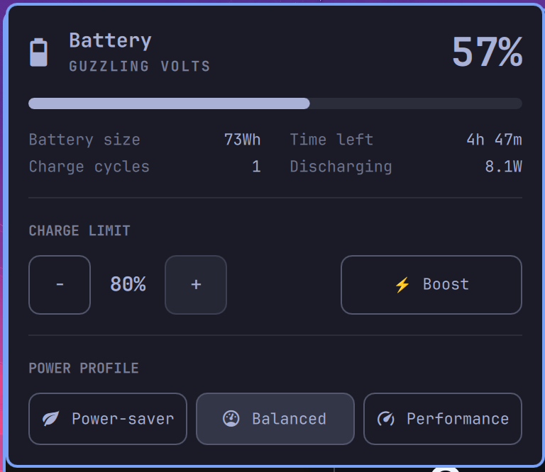

# Framework ChargeLimit Power

An Omarchy shell bar widget for Framework laptops. It combines battery status, power-profile selection, system statistics, an adjustable charge limit, and a one-cycle **Boost** mode.

Framework ChargeLimit Power is derived from Omarchy's built-in `omarchy.power` widget.



## Features

- Battery percentage, state, health, power draw, and estimated time
- AC and battery power-profile selection
- Configurable Framework charge limit in the panel
- Boost mode that temporarily raises the Framework charge limit to 100%
- Automatic restoration of the normal charge limit after UPower reports a full battery
- Optional automatic hibernation at a configurable low-battery percentage
- Battery temperature from the Framework EC's named battery sensor
- CPU, memory, temperature, and uptime statistics

## Requirements

- Omarchy with the Quickshell plugin system
- A Framework laptop supported by `framework_tool`
- The Arch Linux `framework-system` package
- `sudo` 1.9.10 or newer for regular-expression command arguments

Install the Framework tooling with:

```sh
omarchy pkg add framework-system
```

Confirm that the charge-limit command works before installing the plugin:

```sh
sudo /usr/bin/framework_tool --charge-limit
```

## Install

After publishing this repository, install it using its Git URL:

```sh
omarchy plugin add https://github.com/xeTaiz/dome.power.git --enable
```

Omarchy clones the repository into `~/.config/omarchy/plugins/dome.power`, validates `manifest.json`, and prompts for a bar position when running interactively.

Update an installed copy after publishing a new version:

```sh
omarchy plugin update dome.power
```

If it is already installed but not present on the bar:

```sh
omarchy plugin enable dome.power
```

## Passwordless charge-limit permission

The widget runs inside the graphical Omarchy shell, where no terminal is available for a sudo password prompt. It therefore invokes `framework_tool` with `sudo -n` and needs a narrowly scoped sudoers rule.

Open a dedicated sudoers file:

```sh
sudo visudo -f /etc/sudoers.d/dome-power
```

Add the following line, replacing `YOUR_USERNAME` with your Linux username:

```sudoers
YOUR_USERNAME ALL=(root) NOPASSWD: /usr/bin/framework_tool ^--charge-limit([[:space:]]+[0-9]{1,3})?$
```

This permits only these command shapes:

```text
/usr/bin/framework_tool --charge-limit
/usr/bin/framework_tool --charge-limit NUMBER
```

It does not grant passwordless access to other `framework_tool` subcommands. The sudoers expression accepts a one-to-three-digit argument; the plugin itself clamps configurable limits to 40–100%. Regular-expression command arguments require `sudo` 1.9.10 or newer; `visudo` will reject this rule on older releases.

Validate the file before relying on it:

```sh
sudo chmod 0440 /etc/sudoers.d/dome-power
sudo visudo -cf /etc/sudoers.d/dome-power
sudo -n /usr/bin/framework_tool --charge-limit
```

Then reload the shell if the widget was already running:

```sh
omarchy restart shell
```

## Battery temperature permission

The panel displays **Battery temp** and refreshes it every five seconds while
open, using `sudo -n /usr/bin/framework_tool --thermal`. Only the sensor named
`Battery`, `battery_temp`, or `battery_temp@<hex address>` is displayed. Missing sensors and read failures show `—` and an
explanation rather than a stale temperature.

To allow background reads, add this exact read-only command to a sudoers file
with `sudo visudo -f /etc/sudoers.d/framework-battery-temperature`:

```sudoers
YOUR_USERNAME ALL=(root) NOPASSWD: /usr/bin/framework_tool --thermal
```

Replace `YOUR_USERNAME` with your login name, then verify with
`sudo -n /usr/bin/framework_tool --thermal`. Do not grant unrestricted access
to `framework_tool`; this rule permits only its temperature/fan status query.

## Configuration

The widget accepts these optional values in its `shell.json` bar entry:

```json
{
  "id": "dome.power",
  "chargeLimitStep": 10,
  "defaultChargeLimit": 80
}
```

- `defaultChargeLimit`: normal charge ceiling; clamped to 40–100. Default: `80`.
- `chargeLimitStep`: amount changed by the minus and plus buttons. Default: `10`.
- `showPercentage`: show the battery percentage in the bar button. Default: `false`.

Omarchy manages the temporary `chargeToFull` setting when Boost is toggled. It should not normally be edited by hand.

### Low-battery hibernation

The **LOW BATTERY** controls select a threshold from 5–30% (default: 10%) and
toggle **Auto: ON / Auto: OFF**. The button controls automatic hibernation; it does not request immediate manual hibernation. This feature is off by default. The equivalent widget
settings are `"lowBatteryHibernate": true` and `"hibernateThreshold": 10`.

When enabled, the widget checks UPower every 15 seconds, even with the panel
closed, and requests hibernation at or below the threshold while on battery.
Preparing the memory image and writing it to disk may take a minute or more, during which the lock screen may appear unresponsive. Wait for the computer to power off.

This saves the session to disk; it is separate from the Framework charging
ceiling and does not change EC settings. It requires working system
hibernation (swap/resume configured) and logind permission without a password.
`busctl call org.freedesktop.login1 /org/freedesktop/login1 org.freedesktop.login1.Manager CanHibernate`
must return `s "yes"`. No additional passwordless Framework sudo rule is needed.

Requests respect system sleep inhibitors. If hibernation is unavailable or
fails, the panel displays an error; it does not silently substitute suspend
or shutdown. After an attempt, the widget rearms when AC is connected or the
battery rises more than two percentage points above the threshold, avoiding
an immediate hibernation loop after resume. Plugin or shell restarts reset
this guard, so restarting on low battery can request hibernation again.

This protection operates only while Omarchy shell and this widget are running.
It cannot monitor a powered-off or suspended machine. Keep system-level
critical-battery protection enabled as a fallback.

## How Boost turns itself off

Boost sets the Framework charge limit to 100% and records that Boost is active. The widget watches `UPower.displayDevice`; when UPower reports `FullyCharged`, or reports 100% while connected to AC, it restores `defaultChargeLimit` and clears the persisted Boost state.

Automatic disarming depends on UPower reporting one of those full conditions. If a machine remains at 99% and UPower continues to report `Charging`, Boost remains active until it is toggled off manually.

## Remove

```sh
omarchy plugin remove dome.power
sudo rm /etc/sudoers.d/dome-power
```

Removing the plugin does not change the charge limit already stored by the Framework embedded controller. Set the desired limit before removal if necessary:

```sh
sudo /usr/bin/framework_tool --charge-limit 80
```

## Development

Validate a checkout with:

```sh
omarchy plugin validate .
```

User plugin files hot-reload when edited under `~/.config/omarchy/plugins/`. If discovery becomes stale, run:

```sh
omarchy-shell shell rescanPlugins
```
